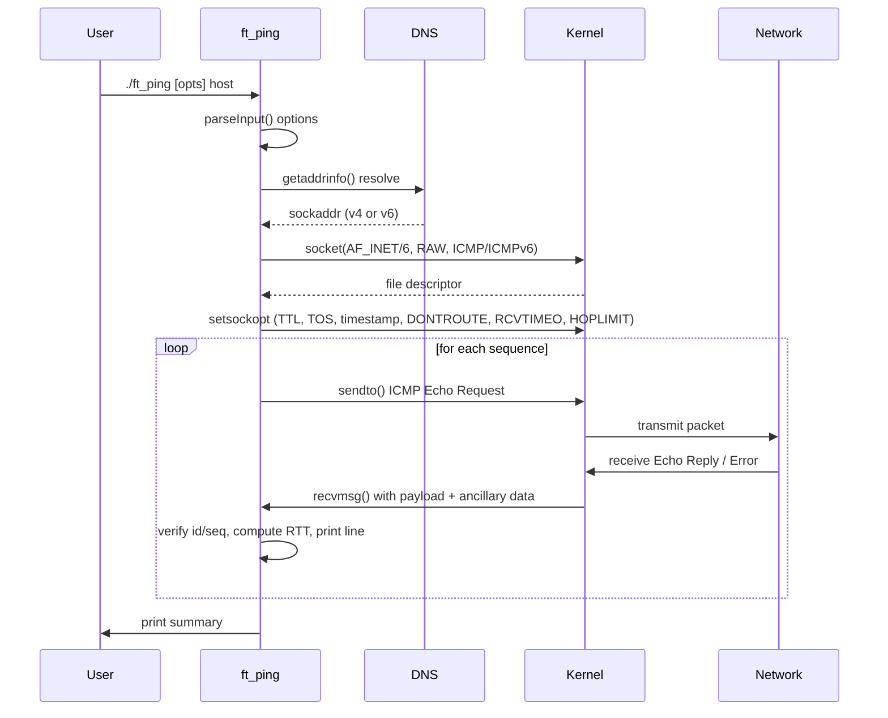

# Project Overview

## What is ft_ping?

`ft_ping` is a from-scratch implementation of the `ping` utility written in C,
using Linux raw sockets (`SOCK_RAW`, `IPPROTO_ICMP` / `IPPROTO_ICMPV6`).
It sends ICMP Echo Request packets and processes ICMP Echo Replies (and error
messages) to measure round-trip time, packet loss, and reachability.

The project is part of the **42 Berlin** curriculum. The behavioral reference is
**inetutils-2.0 `ping`** (GNU inetutils version 2.0). The requirement is
output identical to the reference except for the RTT line and reverse DNS
resolution.

## Feature Matrix

| Category | Features | Status |
|----------|----------|--------|
| **Mandatory (subject)** | IPv4 echo, `-v` verbose, `-?` / `-h` help | Implemented |
| **Bonus (subject)** | `-f` flood, `-l` preload, `-n` numeric, `-w` deadline, `-W` linger, `-p` pattern, `-r` ignore-routing, `-s` size, `-T`/`--ip-timestamp`, `--ttl` | Partially implemented (see CLI reference) |
| **Extra** | IPv6 (`-6`), long options (`--help`, `--usage`, `--ttl`, `--ip-timestamp`) | Implemented |

## High-Level Packet Flow

## Glossary

| Term | Meaning |
|------|---------|
| **ICMP** | Internet Control Message Protocol (RFC 792) |
| **Echo Request / Reply** | ICMP type 8 / 0 (v4) or 128 / 129 (v6) |
| **TTL / Hop Limit** | Time To Live (IPv4) / Hop Limit (IPv6); decremented per router |
| **RTT** | Round-Trip Time; elapsed between send and matching reply |
| **Raw socket** | `SOCK_RAW`; application builds full ICMP packet, kernel adds IP header |
| **inetutils-2.0** | GNU inetutils version 2.0 `ping`; behavioral reference |
| **SO_RCVTIMEO** | Socket receive timeout; controls per-sequence wait |
| **CLOCK_MONOTONIC** | Monotonic clock source; unaffected by system time changes |

---

## See also

- [Networking Fundamentals](02-networking-fundamentals.md)
- [Architecture](07-architecture.md)
- [CLI Reference](08-cli-reference.md)