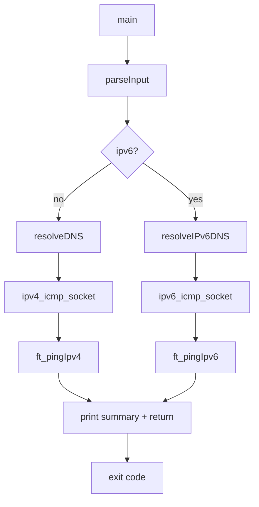
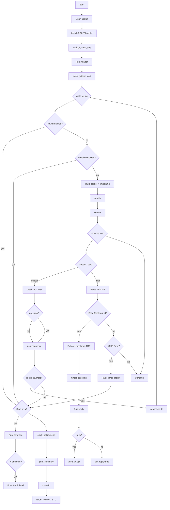

# Architecture

## Repository Layout

```
ft_ping/
├── Makefile
├── README.md
├── en.subject.pdf
├── docs/
│   ├── 00-index.md … 14-references.md
│   └── resources.md
├── includes/
│   └── ft_ping.h
└── srcs/
    ├── main.c
    ├── parse.c
    ├── dns.c
    ├── icmp.c
    ├── socket.c
    ├── ping4.c
    └── ping6.c
```

## Module Responsibilities

| File | Responsibility |
|------|----------------|
| `main.c` | Entry point; parses, resolves, dispatches to v4/v6, propagates exit code |
| `parse.c` | `parseInput()` — `getopt_long`, option validation, usage text, config init |
| `dns.c` | `resolveDNS()` / `resolveIPv6DNS()` — `getaddrinfo`, sockaddr fill, IP string |
| `icmp.c` | Checksum functions, `buildEchoPacket()`, `buildEchoV6Packet()` |
| `socket.c` | `ipv4_icmp_socket()`, `ipv6_icmp_socket()` — socket creation + options |
| `ping4.c` | IPv4 ping loop, send/receive/parse, printing, stats |
| `ping6.c` | IPv6 ping loop (mirrors ping4.c with v6 specifics) |

## Core Data Structures

### `t_config` (includes/ft_ping.h)

```c
typedef struct s_config {
    char    ip_str[INET_ADDRSTRLEN];
    char    ip6_str[INET6_ADDRSTRLEN];
    char    *hostname;
    struct sockaddr_in target_addr;
    struct sockaddr_in6 target_addr6;
    int     count;          // -c
    uint8_t ttl;            // -t / --ttl
    bool    verbose;        // -v
    bool    quiet;          // -q
    bool    numeric;        // -n
    int     timeout_ms;     // -W (seconds * 1000)
    int     packet_size;    // -s (data bytes)
    bool    ipv6;           // -6
    uint16_t pid;           // getpid() & 0xFFFF
    uint8_t pattern;        // -p (default 0x42)
    bool    dontroute;      // -r
    int     deadline;       // -w (seconds)
    int     tos;            // -T (TOS value, -1 = unset)
    int     ip_ts;          // --ip-timestamp flag
    int     ip_ts_type;     // 1=tsonly, 3=tsaddr
} t_config;
```

### `t_logs` (includes/ft_ping.h)

```c
typedef struct s_logs {
    int sent;               // unique sequences sent
    int rec;                // unique replies received
    struct timespec start_time;
    struct timespec end_time;
    double rtt_max;
    double rtt_min;
    double rtt_sum;
    double rtt_mdev;        // standard deviation
} t_logs;
```

## Control Flow



### Main Loop (per-family, `ft_pingIpv4` / `ft_pingIpv6`)



## Send Path Detail

1. **`buildEchoPacket()` / `buildEchoV6Packet()`** (`icmp.c`)
   - Fill ICMP header: type=8/128, code=0, id=pid, seq=seq, checksum=0.
   - Payload: if `packet_size >= sizeof(timespec)`, write `timespec` at offset 0,
     fill remainder with `pattern` (default `0x42`). Else fill all with `pattern`.
   - Compute checksum (v4: `calculateChecksum`; v6: `icmp6_checksum` with
     pseudo-header).
2. **`sendto()`** with target `sockaddr`.
3. On success, `logs.sent++`.

## Receive Path Detail

1. **`recvmsg()`** with `iovec` (2048 bytes), `msghdr` with `msg_name` (source
   sockaddr) and `msg_control` (for Hop Limit cmsg on v6).
2. **IPv4**: buffer contains full IP packet. Parse:
   - `struct iphdr *ip = buf`; `iphdr_len = ip->ihl * 4`.
   - `struct icmphdr *icmp = buf + iphdr_len`.
3. **IPv6**: buffer starts at ICMPv6 header. Parse:
   - `struct icmp6_hdr *icmp6 = buf`.
   - Hop Limit from `cmsg` (`IPV6_HOPLIMIT`).
4. **Echo Reply** (`type == 0/129`, `id == pid`):
   - Extract timestamp from payload (after ICMP header).
   - RTT = `now - sent_ts` (both `CLOCK_MONOTONIC`).
   - `rseq = ntohs(seq)`.
   - Duplicate check: `seen_seq[rseq]` (static `bool[65536]`).
   - Update `logs` (rec, rtt_sum, rtt_sq_sum, min/max).
   - `print_reply()`; if `ip_ts` enabled, `print_ip_opt()` (v4 only).
3. **ICMP Error** (`type != 0/129`):
   - Parse quoted packet via `parseSeqifOur()` / `parseSeqifOur6()`.
   - If `ours || verbose`: print `"%zu bytes from %s: %s\n"`.
   - If `verbose && ours`: parse inner headers, print detail line
     `ICMP: type %u, code %u, size %u, id 0x%04x, seq 0x%04x`.
   - Continue waiting (do not count as reply).

## Duplicate Detection

- Static array: `static bool seen_seq[65536];` (covers all `uint16_t`).
- On Echo Reply: `duplicate = seen_seq[rseq]; seen_seq[rseq] = true;`.
- If duplicate: `duplicates++` (not counted in `logs.rec` for loss calc).
- RTT of duplicates still feeds min/max/avg/mdev.

## Signal Handling

- Global: `static volatile sig_atomic_t g_sig = 0;`.
- `handle_sigint(int)` sets `g_sig = 1` (async-signal-safe).
- Main loop checks `!g_sig` at top and after `recvmsg` timeout.
- On interrupt: breaks loop, prints summary, exits with return code.

## Timing

- **Clock**: `CLOCK_MONOTONIC` (not affected by system time changes).
- **RTT**: `sent_ts` captured before `sendto()`; `now` captured after
  `recvmsg()` returns our Echo Reply. Difference computed in nanoseconds,
  converted to milliseconds (`double`).
- **Interval**: after each sequence (whether reply received or timed out),
  `nanosleep({1, 0})` if not the last packet and not interrupted.
- **Timeout**: `SO_RCVTIMEO` set from `conf->timeout_ms` (default 1000 ms).
  `recvmsg()` blocks up to this duration per sequence.
- **Deadline** (`-w`): wall-clock seconds from `logs.start_time`; checked
  at top of loop; silent break + summary when exceeded.

## Exit Codes

| Code | Meaning |
|------|---------|
| 0 | At least one reply received |
| 1 | Socket failure, DNS failure, or zero replies |
| 64 | Usage error (unknown option, missing host) |

---

## See also

- [CLI Reference](08-cli-reference.md)
- [Output Reference](09-output-reference.md)
- [Timing & Signals](10-timing-and-signals.md)
- [ICMP Protocol](05-icmp.md)